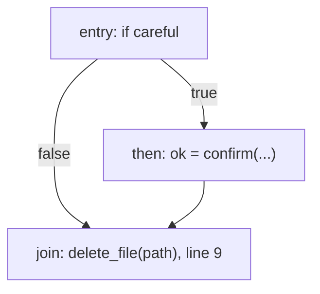

# 07. Approval analysis (headline feature 2: dominators and the approval rule)

## 1. What this phase does

| | |
| --- | --- |
| Input | The list of CFGs (one per task) of the **unoptimized** IR, the same CFGs the taint phase used. Taint has already passed. |
| Output | An `ApprovalReport` with a `{text, data}` artifact for the Approval tab, or a `CompileError` carrying one **E501** or **E502** diagnostic with one offending path. |
| Place in the pipeline | Stage 6 of 10. Runs after taint (stage 5) and before the optimizer (stage 7). |
| Requirements | A1 (tools marked `irreversible`), A2 (every path to an irreversible call passes a `confirm` whose result guards it, checked with dominators), A3 (one offending path shown). |

`delete_file` cannot be undone. This phase proves, before the program runs, that every
`delete_file` call can only execute after a human answered **yes** to a `confirm` question. It
does that with a classic compiler tool, dominator analysis on the CFG.

## 2. Key data structures

| Structure | Type | Purpose |
| --- | --- | --- |
| `CFG`, `BasicBlock` | from `agentscript/ir.py` | Blocks in layout order, `succs` (for a `Branch`: `[if_true, if_false]`) and `preds`. |
| Dominator sets | `dict[str, set[str]]` from `cfg.dominators(cfg)` | `dom[n]` = every block that dominates block `n`. `cfg.immediate_dominators(cfg)` derives the `idom` shown in the report. |
| Reachable set | `set[str]` from `cfg.reachable(cfg)` | Blocks reachable from `entry`. |
| Confirm values | `set[str]` | IR variables that always hold a `confirm` result. |
| Guard blocks | `list[str]`, layout order | True successors of a `Branch` on a confirm value. |
| Irreversible calls | `Call` instructions whose `TOOLS[tool].irreversible` is set | The calls the rule applies to (today only `delete_file`). |
| `ApprovalReport` | per task (`TaskApproval`): the dominator sets and immediate dominators, the guard blocks (`GuardBlock`), and each irreversible call (`IrreversibleCall`) with the innermost guard that dominates it and its verdict (`approved`, `E501`, `E502` or `unreachable`) | `artifact()` gives the Approval tab text and data. IMPLEMENTATION_PLAN.md M5 step 5 fixes this content: dominator sets, guard blocks and a verdict per irreversible call. |

**Dominance.** In a CFG with entry block `entry`, block `d` *dominates* block `n` if every path
from `entry` to `n` passes through `d`. Every block dominates itself, and `entry` dominates every
reachable block. If the guard block dominates the block of a call, there is no way to reach the
call without going through the guard.

**Confirm value.** A variable is a confirm value if every one of its definitions is
`v = call confirm(...)` or a copy `v = w` of a confirm value (a least fixed point, computed by
`confirm_values`). The IR generator gives every variable
(except internal loop counters) exactly one static definition, and AgentScript variables are
immutable, so `ok` in `let ok = confirm("..."); ... if (ok) { ... }` holds the confirm result
everywhere it is visible.

**Guard block.** The block that is the **true successor** of a `Branch` whose condition is a
confirm value. In source terms exactly two forms are accepted:

| Accepted | Not accepted |
| --- | --- |
| `if (confirm("Delete?")) { ... }` | `if (confirm("Delete?") == true) { ... }` (a `BinOp` result, not a confirm value) |
| `let ok = confirm("Delete?"); ... if (ok) { ... }` | any other expression as the condition |
| | a bare `confirm("Delete?");` whose result is never branched on |
| | the `else` branch of an `if` on a confirm value (that is where the answer was **no**) |

The IR generator always gives the `then` block its own label, so a guard block has exactly one
predecessor, the block ending in the `Branch`, and is entered only along the true edge. Being in
a guard block therefore means "confirm was called and returned true".

## 3. Algorithm

**In plain words.**

1. Compute the dominator sets of the task's CFG.
2. Find the confirm values, then the guard blocks.
3. For every irreversible call, in a reachable block `B`: the call is approved if some guard block
   dominates `B`. Otherwise it is a violation.
4. For a violation, pick the error code: **E502** if some block containing a `confirm` call can
   reach `B` (there is a confirm on some path to the call, but its answer does not guard every
   path); **E501** otherwise (the call can run with no confirm at all).
5. Build one offending path with a breadth-first search from `entry` to `B` that avoids the guard
   blocks, and report it.

**Dominators: the simple iterative algorithm.** Start with "everything dominates everything" and
remove blocks until the equations hold:

```
dominators(cfg):
    R = reachable(cfg)                         # unreachable blocks are left out
    dom = {n: set(R) for n in R}
    dom[entry] = {entry}
    changed = True
    while changed:
        changed = False
        for n in R - {entry} (layout order):
            new = {n} ∪ ⋂ { dom[p] : p in preds(n), p in R }
            if new != dom[n]:
                dom[n] = new
                changed = True
    return dom
```

Each set can only shrink and there are finitely many blocks, so the loop terminates. Unreachable
predecessors are ignored. This matters: the IR generator emits a `goto Lend` after a `return` at
the end of a `then` block, which `build_cfg` puts in an unreachable `U` block that is still a
predecessor of `Lend`. Counting it would make dominance depend on code that never runs. (IMPLEMENTATION_PLAN.md
decision D9.)

**Confirm values, guard blocks and the rule.**

```
confirm_values(cfg):
    defs = every instruction that writes each variable in the task
    cv = {}
    repeat until cv stops growing:
        for v, writes in defs:
            if every w in writes is (Call confirm) or (Assign from a Var in cv):
                cv.add(v)
    return cv

analyze_approval(cfgs):
    for cfg in cfgs:                                       # tasks in source order
        R, dom = reachable(cfg), dominators(cfg)
        cv = confirm_values(cfg)
        guards = [b.terminator.if_true for b in R (layout order)
                  if b.terminator is Branch and b.terminator.cond is Var in cv]
        confirm_calls = [ (b, k) : instruction k of reachable block b is a Call to confirm ]
        for b in cfg.blocks (layout order):
            for (k, instr) in b.instrs:
                if instr is Call and TOOLS[instr.tool].irreversible:
                    if b not in R: record (instr, "unreachable"); continue
                    if any(g in dom[b] for g in guards):
                        record (instr, innermost such g, "approved")
                        continue
                    code = "E502" if any(reaches((c, j), (b, k)) for (c, j) in confirm_calls) else "E501"
                    path = bfs(entry, b, avoid=set(guards))
                    if path is None:
                        path = bfs(entry, b, avoid={guards[0]})     # exists: guards[0] does not dominate b
                    record (instr, code); keep the first error of the task, with path
    raise the first kept error (tasks in source order), with the full report attached
    return ApprovalReport(...)
```

`reaches((c, j), (b, k))` is plain graph reachability along `succs` through at least one edge
(block `b` is reachable from block `c`), or the confirm is in the same block *before* the call
(`c == b` and `j <= k`). So `let ok = confirm("..."); delete_file(p);` in one block is E502 (a
confirm is there, but its answer guards nothing), while a confirm that only comes after the call
does not count. Every call is checked and recorded first, so the Approval tab lists all of them
even when compilation fails; the error reported is the first violation in layout order.

**Offending-path BFS.** Breadth-first search finds a *shortest* path, which is the easiest one to
read. Successors are visited in `succs` order (true edge before false edge), so the path is
deterministic.

```
bfs(entry, target, avoid):
    if entry in avoid: return None
    parent = {entry: None}; queue = [entry]
    while queue:
        n = queue.pop(0)
        if n == target: return steps along parent links from entry to target
        for s in succs(n):
            if s not in parent and s not in avoid:
                parent[s] = n; queue.append(s)
    return None
```

The path becomes a list of `PathStep(line, col, note)`: first `task <name> starts (entry)`, then
for each block on the path a step for every `confirm` call asked in it (`confirm(...) is asked
here`) and a step for the edge taken out of it (for a `Branch`: `if <cond> -> true/false (<label>)`,
or `repeat N -> body/exit` for a loop head; otherwise `goto <label>`). The last step is the
irreversible call. The
first search avoids *every* guard, so it shows a path that never got a yes. If no such path exists
(each path passes some guard, but no single guard dominates the call; see limitations), the second
search avoids only the first guard block in layout order; such a path must exist, because that
guard does not dominate the call.

**The two failing demos, by hand (illustrative, drawn at source level; the real CFGs are pasted
in section 5).**

| Program | What the analysis sees | Result |
| --- | --- | --- |
| `examples/approval_missing.as` | `if (force) { return delete_file(path); }` comes *before* the confirm. The block of the line 7 call is not dominated by the guard of `if (confirm(...))` on line 9, and no block with a confirm can reach it. The line 10 call is approved. | **E501** at 7:14 |
| `examples/approval_one_branch.as` | `let ok = confirm(...)` is inside `if (careful)`, and `ok` is never branched on, so there is no guard block at all. The confirm block reaches the `delete_file` call after the `if`. | **E502** at 9:12 |
| `examples/valid_cleanup.as` | `let ok = confirm(...)` then `if (ok) { return delete_file(path); }`. The call sits in the guard block itself, and a block dominates itself. | approved |



*approval_one_branch.as, hand-drawn. No guard block exists, `then` can reach `join`, so E502; the
BFS path is entry → join along the false edge.*

## 4. Worked example

**`examples/valid_report.as`: nothing to guard.** The report of
`.venv/bin/python -m agentscript compile examples/valid_report.as --phase approval`:

```
task report
  dominators:
    entry  dom = {entry}  idom = -
    L1     dom = {entry, L1}  idom = entry
    L2     dom = {entry, L2}  idom = entry
  guard blocks:
    L1  (if confirm(...) on line 9; confirm on line 9)
  irreversible calls:
    (none)
```

`L1` is a guard block (the true successor of `if t3`, where `t3 = call confirm("Send report?")`),
but the only call in it is `send_email`, which is privileged but not `irreversible`. With no
irreversible call, the program passes this phase whatever the guards are.

**`examples/valid_cleanup.as`: an approved `delete_file`.** Its CFG
(`.venv/bin/python -m agentscript compile examples/valid_cleanup.as --phase cfg`):

```
task cleanup(path: string) -> bool
  entry:
      preds: -
      succs: L1, L2
      t1 = "Delete " + path                    ; line 6
      t2 = t1 + "?"                            ; line 6
      ok = call confirm(t2)                    ; line 6
      if ok goto L1 else L2                    ; line 7
  L1:
      preds: entry
      succs: -
      t3 = call delete_file(path)              ; line 8
      return t3                                ; line 8
  L2:
      preds: entry
      succs: -
      return false                             ; line 10
```

and its approval report (`.venv/bin/python -m agentscript compile examples/valid_cleanup.as --phase approval`):

```
task cleanup
  dominators:
    entry  dom = {entry}  idom = -
    L1     dom = {entry, L1}  idom = entry
    L2     dom = {entry, L2}  idom = entry
  guard blocks:
    L1  (if ok on line 7; confirm on line 6)
  irreversible calls:
    delete_file line 8 in L1: guarded by L1 -> approved
```

Walking through it:

1. **Dominators.** `entry` dominates only itself. `L1` and `L2` each have the single predecessor
   `entry`, so `dom(L1) = {entry, L1}` and `dom(L2) = {entry, L2}`; both have `idom = entry`.
2. **Confirm values.** `ok` has one definition, `ok = call confirm(t2)`, so it is a confirm value.
   (`t1` and `t2`, the question text, are not.)
3. **Guard blocks.** `entry` ends in `if ok goto L1 else L2` and `ok` is a confirm value, so the
   true successor `L1` is a guard block. The report names the source condition (`if ok` on line 7)
   and the confirm it comes from (line 6).
4. **The rule.** `t3 = call delete_file(path)` sits in `L1`. `L1` is in `dom(L1)` (every block
   dominates itself), so the guard dominates the call: `guarded by L1 -> approved`. `L2`, the
   `else` path where the answer was no, contains no irreversible call.

## 5. Errors this phase catches

| Code | Demo file | When |
| --- | --- | --- |
| **E501** | `examples/approval_missing.as` | An irreversible call is not dominated by any guard block, and no `confirm` call can reach it: it can run with no confirm at all. |
| **E502** | `examples/approval_one_branch.as` | An irreversible call is not dominated by any guard block, but some `confirm` call can reach it: a confirm exists on some path, but its answer does not guard every path to the call. |

**E501: `examples/approval_missing.as`.** The diagnostic printed by
`.venv/bin/python -m agentscript compile examples/approval_missing.as` (the `== diagnostics ==`
section; the same text ends the Approval tab):

```
E501 [approval] 7:14: irreversible call to 'delete_file' (line 7) is reachable without confirm
    6:5  task purge starts (entry)
    6:5  line 6: if force -> true (L1)
    7:14  delete_file(...) is irreversible and not guarded by confirm
compilation failed
```

The CFG from `.venv/bin/python -m agentscript compile examples/approval_missing.as --phase cfg`
(the CLI prints the diagnostic above the CFG; that repeat is trimmed to the `...` line):

```
...
task purge(path: string, force: bool) -> bool
  entry:
      preds: -
      succs: L1, L2
      if force goto L1 else L2                 ; line 6
  L1:
      preds: entry
      succs: -
      t1 = call delete_file(path)              ; line 7
      return t1                                ; line 7
  L2:
      preds: entry
      succs: L3, L4
      t2 = "Delete " + path                    ; line 9
      t3 = t2 + "?"                            ; line 9
      t4 = call confirm(t3)                    ; line 9
      if t4 goto L3 else L4                    ; line 9
  L3:
      preds: L2
      succs: -
      t5 = call delete_file(path)              ; line 10
      return t5                                ; line 10
  L4:
      preds: L2
      succs: -
      return false                             ; line 12
```

and the approval report from the same compile (its `== approval ==` section, which ends with the
same diagnostic):

```
task purge
  dominators:
    entry  dom = {entry}  idom = -
    L1     dom = {entry, L1}  idom = entry
    L2     dom = {entry, L2}  idom = entry
    L3     dom = {entry, L2, L3}  idom = L2
    L4     dom = {entry, L2, L4}  idom = L2
  guard blocks:
    L3  (if confirm(...) on line 9; confirm on line 9)
  irreversible calls:
    delete_file line 7 in L1: guarded by - -> E501
    delete_file line 10 in L3: guarded by L3 -> approved

E501 [approval] 7:14: irreversible call to 'delete_file' (line 7) is reachable without confirm
    6:5  task purge starts (entry)
    6:5  line 6: if force -> true (L1)
    7:14  delete_file(...) is irreversible and not guarded by confirm
```

The guard block is `L3` (true successor of `if t4`, `t4 = call confirm(t3)`). The line 10 call is
in `L3` itself, so it is approved. The line 7 call is in `L1`, whose dominators are only
`entry` and `L1`; no guard dominates it. The only confirm call is in `L2`, and `L1` is not
reachable from `L2`, so the code is E501. The BFS from `entry` avoiding `L3` takes the true edge of
`if force` straight to `L1`: the path reads "task starts, `force` is true, delete". The location
7:14 matches `examples/manifest.json`.

**E502: `examples/approval_one_branch.as`.** The diagnostic printed by
`.venv/bin/python -m agentscript compile examples/approval_one_branch.as`:

```
E502 [approval] 9:12: irreversible call to 'delete_file' (line 9) is not guarded by confirm on every path; the confirm on line 7 does not guard it
    6:5  task cleanup starts (entry)
    6:5  line 6: if careful -> false (L2)
    9:12  delete_file(...) is irreversible and not guarded by confirm
compilation failed
```

The CFG from `--phase cfg` (the repeated diagnostic above it trimmed to `...`):

```
...
task cleanup(path: string, careful: bool) -> bool
  entry:
      preds: -
      succs: L1, L2
      if careful goto L1 else L2               ; line 6
  L1:
      preds: entry
      succs: L2
      t1 = "Delete " + path                    ; line 7
      t2 = t1 + "?"                            ; line 7
      ok = call confirm(t2)                    ; line 7
      goto L2                                  ; line 6
  L2:
      preds: entry, L1
      succs: -
      t3 = call delete_file(path)              ; line 9
      return t3                                ; line 9
```

and the approval report (`== approval ==` section of the same compile):

```
task cleanup
  dominators:
    entry  dom = {entry}  idom = -
    L1     dom = {entry, L1}  idom = entry
    L2     dom = {entry, L2}  idom = entry
  guard blocks:
    (none)
  irreversible calls:
    delete_file line 9 in L2: guarded by - -> E502

E502 [approval] 9:12: irreversible call to 'delete_file' (line 9) is not guarded by confirm on every path; the confirm on line 7 does not guard it
    6:5  task cleanup starts (entry)
    6:5  line 6: if careful -> false (L2)
    9:12  delete_file(...) is irreversible and not guarded by confirm
```

`ok` is a confirm value, but no `Branch` tests it, so there are no guard blocks at all and nothing
can dominate `L2`, where the call is. The confirm call is in `L1`, and `L2` is reachable from `L1`
(the `goto L2` that ends the `if`), so the code is E502 and the message names that confirm (line
7). With no guards to avoid, the BFS finds the shortest path `entry -> L2`, along the false edge of
`if careful`: the run where the confirm is never even asked. The location 9:12 matches
`examples/manifest.json`. The real CFG is the one drawn by hand in section 3.

## 6. Design decisions and limitations

**Why it works this way**

| Decision | Why |
| --- | --- |
| Dominance, not "some path has a confirm" | A2 says *every* path to the call must pass the approval. "For all paths" over a CFG is exactly what dominance means, and the iterative algorithm is short, standard (it is the one in the Dragon Book) and easy to trace by hand in a viva. |
| Dominance of the guard block, not of the confirm **call** | `confirm` can return **false**. In `let ok = confirm("Delete?"); delete_file(p);` the confirm call dominates the delete, yet the file is deleted even when the human says no. Only the true successor of a branch on the answer is reached exactly when the answer was yes, so that is the block that must dominate. |
| Accept only two syntactic forms | The recogniser stays tiny and obviously correct: a confirm value is defined only by `confirm` or a copy of one. Accepting `confirm(...) == true` would need constant reasoning, and then `!= false`, `== false` in an `else` branch and so on. The fix for a rejected program is always one edit. |
| E501 vs E502 | Both are the same rule failing; the split gives a better message and matches taxonomy rows 8 and 9. E501 says "you forgot to ask"; E502 says "you asked, but the answer does not protect this call". |
| One shortest offending path | A3 asks for one path. The shortest one is the easiest to read, and BFS with a fixed successor order makes it deterministic for golden tests. |
| Run on the **unoptimized** IR | As for taint: the guarantee must not depend on the optimizer. The optimizer never moves a call between blocks and only deletes blocks that cannot run, which can only make dominance stronger (see `08-optimizer.md`). |
| Unreachable blocks are ignored | A call there can never run, and an unreachable predecessor must not weaken dominance (the `goto` after a `return`). The optimizer deletes these blocks later anyway. |

**Limitations**

| Limitation | Example | Workaround |
| --- | --- | --- |
| Two confirms on two branches before a join do not count | `if (urgent) { if (confirm("Now?")) { } else { return false; } } else { if (confirm("Later?")) { } else { return false; } }` then `return delete_file(path);`. Every path really did get a yes, but neither guard block alone dominates the call (no single dominator), so it is rejected with E502. | Ask one confirm before the branch. |
| `== true` and other expressions are not accepted | `if (confirm("Delete?") == true)` is rejected (E502, since a confirm block reaches the call). | Write `if (confirm("Delete?"))`. |
| The confirm is mocked by default | In mock mode `confirm` returns the run's confirm answer (default true; `--deny-confirm` or `"confirm": false` in `/run` makes it false). | The compile-time check is the guarantee; the runtime "human" is simulated for the demo. |
| The question text is not checked | `confirm("Continue?")` guards `delete_file("/")` just as well as an honest question. | Out of scope: the analysis proves *that* a yes was obtained, not that the human understood. |
| One yes licenses many calls | `if (ok) { repeat 3 { delete_file(p); } }` deletes three times after one approval. | Intended: approval guards a code region. |
| Only `irreversible` tools need approval | `send_email` is privileged (a taint sink) but not irreversible; `valid_report.as` confirms before emailing by choice, not because the compiler requires it. | Follows the PRD's tool table. |

The early-return form *is* accepted: `if (confirm("Delete?")) { } else { return false; }` followed
by `return delete_file(path);`. The `else` block returns, so the only reachable predecessor of the
join block is the guard block, which therefore dominates the call.

## 7. Where it lives in the code

| File | What is there |
| --- | --- |
| `agentscript/approval.py` | The whole phase. `analyze_approval(cfgs) -> ApprovalReport` builds a `_TaskChecker` per CFG, calls `check()`, and raises the first task's violation (E501 or E502 via `make_error`) with the full report attached as `err.artifact`. In `_TaskChecker`: `__init__` collects the reachable blocks, dominators, definitions (`_definitions`), confirm values, guard blocks and every reachable confirm call with its forward reach (`_forward_reach`); `_find_guards` finds the guard blocks; `_check_call` applies the rule and picks E501/E502 (`_innermost_guard`, `_reaching_confirm`); `_path_steps` turns the BFS path into `PathStep`s. `confirm_values(defs)` is the least-fixed-point recogniser (with `_is_confirm_write`); `_shortest_path(cfg, target, avoid)` is the offending-path BFS; `_Describer` turns IR temporaries and branch edges back into source text (`if ok`, `confirm(...)`, `repeat N`). Data classes: `GuardBlock`, `IrreversibleCall`, `TaskApproval`, and `ApprovalReport` with `artifact()` (`{text, data}`). |
| `agentscript/cfg.py` | `reachable(cfg)` (blocks reachable from `entry`), `dominators(cfg)` (the iterative algorithm over the reachable blocks, ignoring unreachable predecessors) and `immediate_dominators(cfg)` (the strict dominator with the largest dominator set). `build_cfg` and `link_blocks` produce the `succs`/`preds` the analysis walks. |
| `agentscript/tools.py` | `TOOLS`, whose `irreversible` flag marks the calls that need approval (`delete_file`). |
| `agentscript/pipeline.py` | Stage `approval`: `res.approval = analyze_approval(res.cfgs)` on the same unoptimized CFGs as taint, right after `analyze_taint` and before `optimize`; the artifact goes into `phases["approval"]`. On a `CompileError` the pipeline stores `err.artifact` as the Approval tab. |
| `tests/test_approval.py` | The three demos (`test_valid_cleanup_passes_with_let_guard`, `test_valid_report_passes_send_email_is_not_irreversible`, `test_approval_missing_is_e501_through_force_edge`, `test_approval_one_branch_is_e502`), the manifest examples, artifacts and determinism, and one test per rule or limitation: direct `if (confirm(...))`, the `else` branch, a call after the join, nested guards, `== true` rejected, copies of confirm values, two confirms on two branches rejected, the early-return form accepted, `repeat` inside and around guards, unreachable calls ignored, a bare confirm in the same block, a confirm after the call, a bool parameter, several violations and tasks, and `confirm_values` itself (`test_confirm_values_fixed_point`). |
