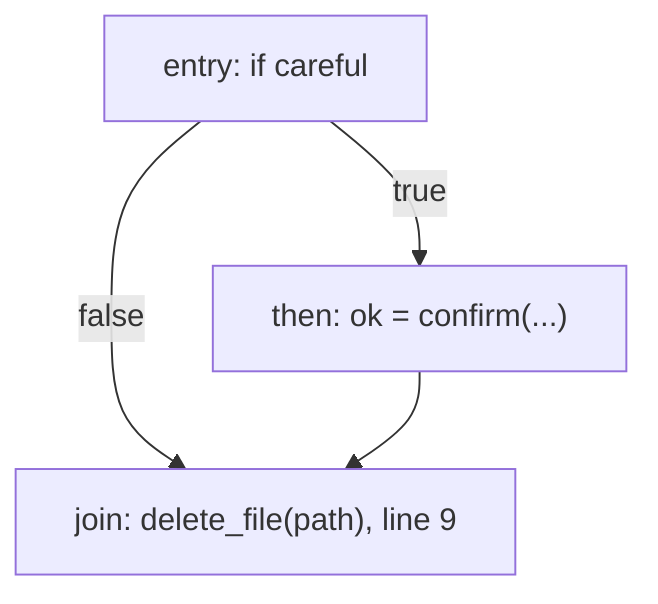

# 07. Approval analysis (headline feature 2: dominators and the approval rule)

## 1. What this phase does

| | |
| --- | --- |
| Input | The list of CFGs (one per task) of the **unoptimized** IR, the same CFGs the taint phase used. Taint has already passed. |
| Output | An `ApprovalReport` with a `{text, data}` artifact for the Approval tab, or a `CompileError` carrying one **E501** or **E502** diagnostic with one offending path. |
| Place in the pipeline | Stage 6 of 10. Runs after taint (stage 5) and before the optimizer (stage 7). |
| Requirements | A1 (tools marked `irreversible`), A2 (every path to an irreversible call passes a `confirm` whose result guards it, checked with dominators), A3 (one offending path shown). |

`delete_file` cannot be undone. This phase proves, before the program runs, that every
`delete_file` call can only execute after a human answered **yes** to a `confirm` question. It
does that with a classic compiler tool, dominator analysis on the CFG.

## 2. Key data structures

| Structure | Type | Purpose |
| --- | --- | --- |
| `CFG`, `BasicBlock` | from `agentscript/ir.py` | Blocks in layout order, `succs` (for a `Branch`: `[if_true, if_false]`) and `preds`. |
| Dominator sets | `dict[str, set[str]]` from `cfg.dominators(cfg)` | `dom[n]` = every block that dominates block `n`. |
| Reachable set | `set[str]` from `cfg.reachable(cfg)` | Blocks reachable from `entry`. |
| Confirm values | `set[str]` | IR variables that always hold a `confirm` result. |
| Guard blocks | `list[str]`, layout order | True successors of a `Branch` on a confirm value. |
| Irreversible calls | `Call` instructions whose `TOOLS[tool].irreversible` is set | The calls the rule applies to (today only `delete_file`). |
| `ApprovalReport` | per task: guard blocks, each irreversible call and the guard that dominates it, and the dominator sets | `artifact()` gives the Approval tab text and data. IMPLEMENTATION_PLAN.md M5 step 5 fixes this content: dominator sets, guard blocks and a verdict per irreversible call. |

**Dominance.** In a CFG with entry block `entry`, block `d` *dominates* block `n` if every path
from `entry` to `n` passes through `d`. Every block dominates itself, and `entry` dominates every
reachable block. If the guard block dominates the block of a call, there is no way to reach the
call without going through the guard.

**Confirm value.** A variable is a confirm value if its only definition is `v = call confirm(...)`,
or its only definition is a copy `v = w` of a confirm value. The IR generator gives every variable
(except internal loop counters) exactly one static definition, and AgentScript variables are
immutable, so `ok` in `let ok = confirm("..."); ... if (ok) { ... }` holds the confirm result
everywhere it is visible.

**Guard block.** The block that is the **true successor** of a `Branch` whose condition is a
confirm value. In source terms exactly two forms are accepted:

| Accepted | Not accepted |
| --- | --- |
| `if (confirm("Delete?")) { ... }` | `if (confirm("Delete?") == true) { ... }` (a `BinOp` result, not a confirm value) |
| `let ok = confirm("Delete?"); ... if (ok) { ... }` | any other expression as the condition |
| | a bare `confirm("Delete?");` whose result is never branched on |
| | the `else` branch of an `if` on a confirm value (that is where the answer was **no**) |

The IR generator always gives the `then` block its own label, so a guard block has exactly one
predecessor, the block ending in the `Branch`, and is entered only along the true edge. Being in
a guard block therefore means "confirm was called and returned true".

## 3. Algorithm

**In plain words.**

1. Compute the dominator sets of the task's CFG.
2. Find the confirm values, then the guard blocks.
3. For every irreversible call, in a reachable block `B`: the call is approved if some guard block
   dominates `B`. Otherwise it is a violation.
4. For a violation, pick the error code: **E502** if some block containing a `confirm` call can
   reach `B` (there is a confirm on some path to the call, but its answer does not guard every
   path); **E501** otherwise (the call can run with no confirm at all).
5. Build one offending path with a breadth-first search from `entry` to `B` that avoids the guard
   blocks, and report it.

**Dominators: the simple iterative algorithm.** Start with "everything dominates everything" and
remove blocks until the equations hold:

```
dominators(cfg):
    R = reachable(cfg)                         # unreachable blocks are left out
    dom = {n: set(R) for n in R}
    dom[entry] = {entry}
    changed = True
    while changed:
        changed = False
        for n in R - {entry} (layout order):
            new = {n} ∪ ⋂ { dom[p] : p in preds(n), p in R }
            if new != dom[n]:
                dom[n] = new
                changed = True
    return dom
```

Each set can only shrink and there are finitely many blocks, so the loop terminates. Unreachable
predecessors are ignored. This matters: the IR generator emits a `goto Lend` after a `return` at
the end of a `then` block, which `build_cfg` puts in an unreachable `U` block that is still a
predecessor of `Lend`. Counting it would make dominance depend on code that never runs. (IMPLEMENTATION_PLAN.md
decision D9.)

**Confirm values, guard blocks and the rule.**

```
confirm_values(cfg):
    defs = number of definitions of each variable in the task
    cv = { c.dst : c is Call confirm, defs[c.dst] == 1 }
    repeat until cv stops growing:
        for a in Assign instructions with a.src a Var in cv and defs[a.dst] == 1:
            cv.add(a.dst)
    return cv

analyze_approval(cfgs):
    for cfg in cfgs:                                       # tasks in source order
        R, dom = reachable(cfg), dominators(cfg)
        cv = confirm_values(cfg)
        guards = [b.terminator.if_true for b in cfg.blocks (layout order)
                  if b.terminator is Branch and b.terminator.cond is Var in cv]
        confirm_blocks = { b : b contains a Call to confirm }
        for b in cfg.blocks (layout order), b in R:
            for instr in b.instrs:
                if instr is Call and TOOLS[instr.tool].irreversible:
                    if any(g in dom[b] for g in guards):
                        record (instr, guard)                       # approved
                        continue
                    code = "E502" if any(reaches(c, b) for c in confirm_blocks) else "E501"
                    path = bfs(entry, b, avoid=set(guards))
                    if path is None:
                        path = bfs(entry, b, avoid={guards[0]})     # exists: guards[0] does not dominate b
                    raise code at (instr.line, instr.col), path
    return ApprovalReport(...)
```

`reaches(c, b)` is plain graph reachability between blocks along `succs`; a block reaches itself,
so `let ok = confirm("..."); delete_file(p);` in one block is E502 (a confirm is there, but its
answer guards nothing).

**Offending-path BFS.** Breadth-first search finds a *shortest* path, which is the easiest one to
read. Successors are visited in `succs` order (true edge before false edge), so the path is
deterministic.

```
bfs(entry, target, avoid):
    if entry in avoid: return None
    parent = {entry: None}; queue = [entry]
    while queue:
        n = queue.pop(0)
        if n == target: return steps along parent links from entry to target
        for s in succs(n):
            if s not in parent and s not in avoid:
                parent[s] = n; queue.append(s)
    return None
```

Each `PathStep(line, col, note)` describes one block on the path and the edge taken out of it (for
a `Branch`: whether the condition was true or false); the last step is the irreversible call. The
first search avoids *every* guard, so it shows a path that never got a yes. If no such path exists
(each path passes some guard, but no single guard dominates the call; see limitations), the second
search avoids only the first guard block in layout order; such a path must exist, because that
guard does not dominate the call.

**The two failing demos, by hand (illustrative, drawn at source level; the real CFGs are pasted
in section 5).**

| Program | What the analysis sees | Result |
| --- | --- | --- |
| `examples/approval_missing.as` | `if (force) { return delete_file(path); }` comes *before* the confirm. The block of the line 7 call is not dominated by the guard of `if (confirm(...))` on line 9, and no block with a confirm can reach it. The line 10 call is approved. | **E501** at 7:14 |
| `examples/approval_one_branch.as` | `let ok = confirm(...)` is inside `if (careful)`, and `ok` is never branched on, so there is no guard block at all. The confirm block reaches the `delete_file` call after the `if`. | **E502** at 9:12 |
| `examples/valid_cleanup.as` | `let ok = confirm(...)` then `if (ok) { return delete_file(path); }`. The call sits in the guard block itself, and a block dominates itself. | approved |



*approval_one_branch.as, hand-drawn. No guard block exists, `then` can reach `join`, so E502; the
BFS path is entry → join along the false edge.*

## 4. Worked example

> Filled in at M5: paste the real approval report printed by `.venv/bin/python -m agentscript compile examples/valid_report.as --phase approval` (no irreversible call, so nothing to guard) and by `.venv/bin/python -m agentscript compile examples/valid_cleanup.as --phase approval` (the guard block, the dominator sets and the approved `delete_file`).

## 5. Errors this phase catches

> Filled in at M5: paste the exact diagnostics and paths printed by `.venv/bin/python -m agentscript compile examples/approval_missing.as` (expected E501 at 7:14) and `.venv/bin/python -m agentscript compile examples/approval_one_branch.as` (expected E502 at 9:12), with the CFG of each from `--phase cfg`.

## 6. Design decisions and limitations

**Why it works this way**

| Decision | Why |
| --- | --- |
| Dominance, not "some path has a confirm" | A2 says *every* path to the call must pass the approval. "For all paths" over a CFG is exactly what dominance means, and the iterative algorithm is short, standard (it is the one in the Dragon Book) and easy to trace by hand in a viva. |
| Dominance of the guard block, not of the confirm **call** | `confirm` can return **false**. In `let ok = confirm("Delete?"); delete_file(p);` the confirm call dominates the delete, yet the file is deleted even when the human says no. Only the true successor of a branch on the answer is reached exactly when the answer was yes, so that is the block that must dominate. |
| Accept only two syntactic forms | The recogniser stays tiny and obviously correct: a confirm value is defined only by `confirm` or a copy of one. Accepting `confirm(...) == true` would need constant reasoning, and then `!= false`, `== false` in an `else` branch and so on. The fix for a rejected program is always one edit. |
| E501 vs E502 | Both are the same rule failing; the split gives a better message and matches taxonomy rows 8 and 9. E501 says "you forgot to ask"; E502 says "you asked, but the answer does not protect this call". |
| One shortest offending path | A3 asks for one path. The shortest one is the easiest to read, and BFS with a fixed successor order makes it deterministic for golden tests. |
| Run on the **unoptimized** IR | As for taint: the guarantee must not depend on the optimizer. The optimizer never moves a call between blocks and only deletes blocks that cannot run, which can only make dominance stronger (see `08-optimizer.md`). |
| Unreachable blocks are ignored | A call there can never run, and an unreachable predecessor must not weaken dominance (the `goto` after a `return`). The optimizer deletes these blocks later anyway. |

**Limitations**

| Limitation | Example | Workaround |
| --- | --- | --- |
| Two confirms on two branches before a join do not count | `if (urgent) { if (confirm("Now?")) { } else { return false; } } else { if (confirm("Later?")) { } else { return false; } }` then `return delete_file(path);`. Every path really did get a yes, but neither guard block alone dominates the call (no single dominator), so it is rejected with E502. | Ask one confirm before the branch. |
| `== true` and other expressions are not accepted | `if (confirm("Delete?") == true)` is rejected (E502, since a confirm block reaches the call). | Write `if (confirm("Delete?"))`. |
| The confirm is mocked by default | In mock mode `confirm` returns the run's confirm answer (default true; `--deny-confirm` or `"confirm": false` in `/run` makes it false). | The compile-time check is the guarantee; the runtime "human" is simulated for the demo. |
| The question text is not checked | `confirm("Continue?")` guards `delete_file("/")` just as well as an honest question. | Out of scope: the analysis proves *that* a yes was obtained, not that the human understood. |
| One yes licenses many calls | `if (ok) { repeat 3 { delete_file(p); } }` deletes three times after one approval. | Intended: approval guards a code region. |
| Only `irreversible` tools need approval | `send_email` is privileged (a taint sink) but not irreversible; `valid_report.as` confirms before emailing by choice, not because the compiler requires it. | Follows the PRD's tool table. |

The early-return form *is* accepted: `if (confirm("Delete?")) { } else { return false; }` followed
by `return delete_file(path);`. The `else` block returns, so the only reachable predecessor of the
join block is the guard block, which therefore dominates the call.

## 7. Where it lives in the code

> Filled in at M5: list `agentscript/approval.py` (`analyze_approval(cfgs)`, `ApprovalReport` and its `artifact()`, the confirm-value and guard-block helpers, the offending-path BFS) and `dominators(cfg)` / `reachable(cfg)` in `agentscript/cfg.py`, how `agentscript/pipeline.py` calls them, and the tests in `tests/test_approval.py`.
